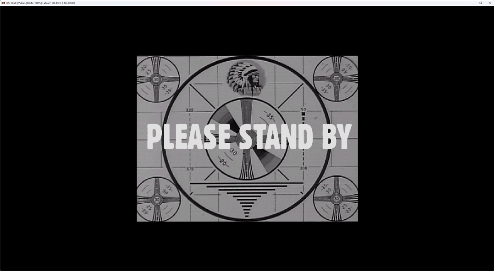
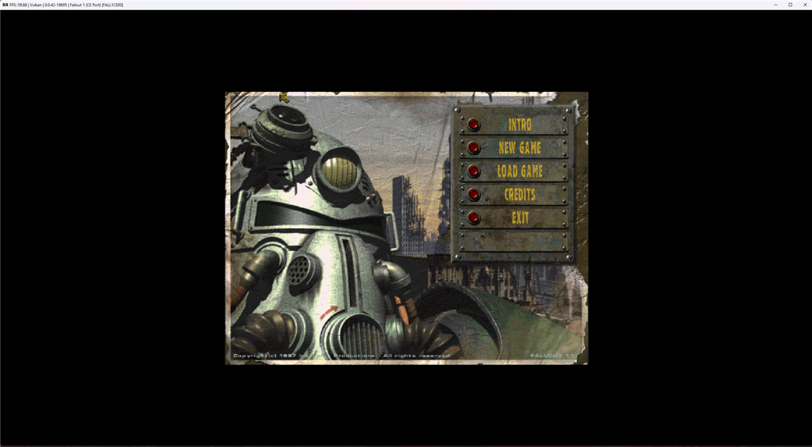
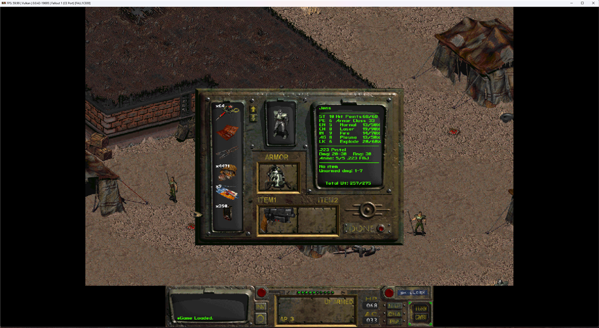
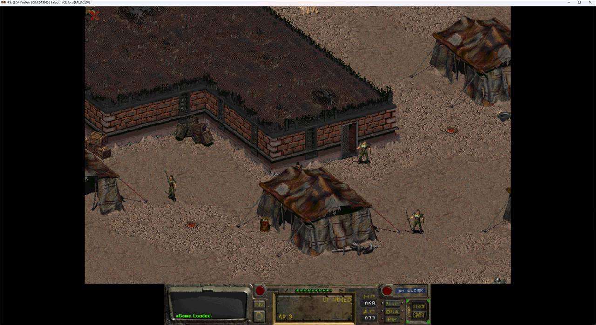

# Fallout 1 (CE Port) — PlayStation 3

A native PlayStation 3 homebrew port of **Fallout 1**, built on
[Fallout Community Edition](https://github.com/alexbatalov/fallout1-ce).

This is not an emulator: the engine is cross-compiled for the Cell PPU and
renders through an RSX-accelerated SDL2 backend. **No CFW required** — the
package installs on any PS3 running PS3HEN. It also runs under RPCS3.

## Screenshots

| | |
|---|---|
|  |  |
|  |  |

## Status

| Area | State |
|------|-------|
| Engine (game logic, DAT archives, save/load) | ✅ |
| Rendering (640×480 via RSX) | ✅ |
| Audio (music, sound effects, speech) | ✅ |
| MVE movies (intro and cutscenes) | ✅ |
| Gamepad (cursor emulation + full button map) | ✅ |
| Text input (PS3 on-screen keyboard) | ✅ |
| USB mouse and keyboard | ✅ |
| Hi-res patch | ❌ Not supported (native 640×480) |

Verified on real hardware (PS3 FAT with PS3HEN) and on RPCS3.

## Requirements

- **Docker** (Linux containers) — the toolchain and every build step run inside
  the image, so no host-side SDK installation is needed.
- **A legal copy of Fallout 1** (GOG / Steam / Epic). Neither this repository
  nor the packages it produces contain any game data.
- To play: a PS3 with PS3HEN, or RPCS3 with official firmware installed.

## Installing

1. Install the package:
   - **PS3:** copy `fallout-ce.gnpdrm.pkg` to the root of a USB drive and
     install it from the console's Package Installer.
   - **RPCS3:** `File → Install Packages`, select `fallout-ce.pkg`.
2. Copy your game data into the installed directory:

```
/dev_hdd0/game/FALL1CE00/USRDIR/
    ├── MASTER.DAT
    ├── CRITTER.DAT
    ├── DATA/
    └── fallout.cfg      (optional)
```

Take these from the root of your PC installation. Use FTP or USB on a real
console; under RPCS3 you can copy straight into its `dev_hdd0` folder. No
further configuration is required — saves are written to `DATA/SAVEGAME/`
inside the same directory.

## Building from source

### 1. Toolchain image (one time)

```bash
docker build -t ps3dev -f docker/Dockerfile .
```

The cross-compilers are built from source, so expect 1.5–2 hours. Exporting the
finished image afterwards saves that time if Docker ever prunes it:

```bash
docker save ps3dev -o ps3dev-image.tar     # restore with: docker load -i ps3dev-image.tar
```

### 2. Engine

```bash
docker run --rm -v "$PWD":/src -w /src/fallout1-ce ps3dev bash -c \
  'cmake -B build-ps3 -DCMAKE_TOOLCHAIN_FILE=cmake/toolchain/ps3.cmake && cmake --build build-ps3 -j'
```

Output: `fallout1-ce/build-ps3/fallout-ce` (big-endian PowerPC64 ELF64).

### 3. Package

```bash
docker run --rm -v "$PWD":/src -w /src/pkg ps3dev make
```

Two packages are written to `build/`: `fallout-ce.pkg` for RPCS3 and
`fallout-ce.gnpdrm.pkg` for retail consoles running HEN. The title ID
(`FALL1CE00`) matches the data path compiled into the engine, so the EBOOT and
the game data end up in the same directory.

For local testing you may drop game data into `pkg/pkgfiles/USRDIR/` to have it
bundled into the package. That directory is not tracked by git, and a package
built this way must not be redistributed.

## Controls

| Input | Action |
|-------|--------|
| Left stick | Cursor |
| Right stick | Scroll map |
| ✕ | Left click (action / move) |
| ○ | Right click (cycle cursor mode) |
| R2 (hold) | 3× cursor speed |
| R1 | Cycle weapon mode |
| L1 | Swap active hand (slot 1 ↔ 2) |
| L2 | End turn (combat) |
| Square | Inventory |
| Triangle | Character screen |
| D-pad ↑ / ↓ | PIP-Boy / Skilldex |
| D-pad ← / → | Enter combat / End combat |
| Start / Select | Game menu / Automap |
| L3 + R3 | Reserved |

The cursor sits on the left stick so the right thumb stays on ✕ during
drag-and-drop, which the inventory relies on.

Wherever the game expects typed text — character name, save description, the
"Tell me about" dialogue field — the PS3 on-screen keyboard opens automatically,
pre-filled with the current contents. Confirming replaces the field; cancelling
falls back to regular keyboard input, so a USB keyboard still works.

## Repository layout

| Path | Contents |
|------|----------|
| `docker/` | Dockerfile for the ps3dev toolchain image |
| `fallout1-ce/` | Engine source: upstream plus PS3 platform support (vendored) |
| `SDL2_PSL1GHT/` | SDL2 port: upstream plus renderer fixes (vendored) |
| `patches/` | Diffs of both vendored trees against upstream, with base commits |
| `pkg/` | Package build: Makefile and icon |

## Implementation notes

- **Toolchain.** The port builds against the [ps3aqua](https://github.com/ps3aqua)
  fork set: `ps3toolchain` (GCC 7.5 with a PS3-patched newlib), the `PSL1GHT`
  SDK and `SDL2_PSL1GHT`. These three are patched against each other; mixing
  them with the upstream ps3dev components does not compile. The Dockerfile
  assembles all of it in one image.
- **Big endian.** The Cell is big-endian while every binary format the game
  ships is little-endian. Endian-safe accessors were added for DAT payloads,
  `.fon` and `.aaf` fonts, the MVE bitstream and audio sample seeds.
- **Fixes worth upstreaming.** `getOffset()` in `movie_lib.cc` truncated motion
  offsets to `uint8_t`, which corrupts blocks during MVE playback on any
  platform. See [patches/README.md](patches/README.md) for this and other
  platform-independent corrections.
- **SDL2 renderer.** Viewport and clip handling was fixed for the SDL 2.30 API,
  along with colour and coordinate propagation through the render command queue.
  Behaviour on little-endian platforms is unchanged.
- **PSL1GHT constraints.** There is no OpenGL (the SDL window is created without
  the GL flag), and hardware surface copies do not alpha-blend. Overlay-style
  drawing therefore has to be composed on a CPU-side surface and uploaded in one
  transfer.
- **Path resolution.** The engine resolves filename case by scanning
  directories on every open. On PS3 that scan starts inside the data directory
  instead of the filesystem root, and results are cached, which cuts filesystem
  syscalls by more than half.

## Troubleshooting

- **RPCS3 memory usage keeps climbing.** Lower the emulator's log level
  (`Log` → Fatal/Success); verbose `sys_fs` logging is expensive over long
  sessions.
- **The game starts and exits immediately.** The game data is not in the
  directory listed above. Under RPCS3, `TTY.log` shows the engine's startup
  steps and where it stopped.
- **`cannot execute: required file not found` while building on Windows.** Git's
  line-ending conversion has mangled shell scripts. This repository disables it
  via `.gitattributes`; on an older clone, run `git config core.autocrlf false`
  and check the tree out again.

## Credits

- [alexbatalov/fallout1-ce](https://github.com/alexbatalov/fallout1-ce) — the engine
- [ps3aqua](https://github.com/ps3aqua) — SDL2_PSL1GHT, PSL1GHT and toolchain forks
- The [ps3dev](https://github.com/ps3dev) community — the PSL1GHT ecosystem
- [RPCS3](https://rpcs3.net) — invaluable during development

## Legal

This repository contains and distributes no copyrighted Fallout assets. Fallout
is a trademark of Bethesda Softworks. You need a legal copy of the game to play.
The engine source is subject to the same license terms as upstream fallout1-ce
(see `fallout1-ce/LICENSE.md`).
